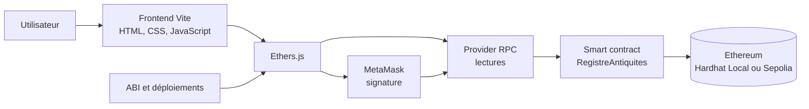

# AntiqueChain – Traçabilité des Antiquités sur Blockchain Ethereum

AntiqueChain est une application décentralisée (DApp) destinée à enregistrer la certification d’antiquités, leur propriétaire initial, leurs transferts et leurs ventes. Le registre est porté par un smart contract Ethereum et l’interface web permet de le consulter et d’interagir avec lui via MetaMask.

> La blockchain rend traçables les informations enregistrées et les opérations qui suivent. Elle ne prouve pas, à elle seule, l’authenticité physique d’une antiquité : cette appréciation reste du ressort de l’expert qui certifie l’objet.

## Problématique

Le parcours de propriété d’une antiquité est souvent difficile à établir : les informations peuvent être incomplètes, dispersées entre plusieurs intervenants ou impossibles à vérifier rapidement. Cette situation accroît le risque de litiges et rend la provenance plus difficile à documenter.

AntiqueChain propose un registre transparent et vérifiable sur Ethereum. Une fois une certification, un transfert ou une vente enregistrés, l’opération peut être consultée depuis la blockchain associée au réseau utilisé.

## Solution proposée

Le contrat `RegistreAntiquites` désigne le compte qui le déploie comme expert. Seul cet expert peut créer une fiche d’antiquité et en attribuer le premier propriétaire. Le propriétaire courant peut ensuite transférer l’objet, le mettre en vente ou retirer l’annonce. Un acheteur peut acquérir un objet mis en vente en envoyant le montant exact en ETH.

Chaque certification, transfert et vente ajoute un événement à l’historique de l’objet. Les lectures du registre sont publiques ; les écritures nécessitent une transaction signée.

## Fonctionnalités principales

- Certification d’une antiquité par le compte expert autorisé.
- Attribution d’un premier propriétaire lors de la certification.
- Contrôle d’accès pour l’expert et le propriétaire courant.
- Transfert de propriété vers une autre adresse.
- Mise en vente, retrait de vente et achat au prix exact en ETH.
- Consultation publique de la liste, de la fiche et de l’historique des antiquités.
- Connexion et signature de transactions via MetaMask.
- Prise en charge de Hardhat Local (chain ID `31337`) et Ethereum Sepolia (chain ID `11155111`).

## Architecture



Le frontend utilise l’ABI de `contract-info.json` pour encoder les appels au contrat. `deployments.json` associe une adresse de contrat et un RPC à chaque réseau. Ethers.js utilise un provider RPC pour les lectures ; MetaMask fournit le signer nécessaire aux transactions qui modifient l’état.

## Technologies utilisées

| Technologie | Rôle dans le projet |
| --- | --- |
| Solidity | Implémentation du smart contract `RegistreAntiquites`. |
| Ethereum | Réseau de registre distribué qui conserve l’état et les transactions. |
| Hardhat | Compilation, réseau local, tests et scripts de déploiement. |
| Sepolia | Réseau public de test Ethereum utilisé pour le déploiement de démonstration. |
| Ethers.js | Lecture du contrat, préparation et envoi des transactions. |
| MetaMask | Connexion du portefeuille et signature côté utilisateur. |
| JavaScript | Logique des scripts Hardhat et de l’interface. |
| HTML / CSS | Structure et présentation de l’interface web. |
| Vite | Serveur de développement et construction du frontend. |
| ABI et RPC | Description de l’interface du contrat et accès aux nœuds Ethereum. |

## Structure du projet

```text
.
├── contracts/
│   └── RegistreAntiquites.sol
├── data/
│   └── objets.json
├── frontend/
│   ├── public/images/
│   ├── src/
│   │   ├── contract-info.json
│   │   ├── contract.js
│   │   ├── deployments.json
│   │   ├── main.js
│   │   └── style.css
│   ├── index.html
│   └── vite.config.js
├── scripts/
│   ├── deploy.js
│   ├── seed.js
│   ├── seed-sepolia.js
│   ├── download-images.js
│   └── ipfs-upload-server.js
├── test/
│   └── RegistreAntiquites.test.js
├── hardhat.config.js
├── package.json
└── .env.example
```

Les dossiers générés tels que `node_modules`, `artifacts`, `cache` et `frontend/dist` ne font pas partie de l’arborescence à versionner.

| Fichier | Rôle |
| --- | --- |
| `contracts/RegistreAntiquites.sol` | Définit le registre, les droits d’accès, les opérations et l’historique. |
| `scripts/deploy.js` | Déploie le contrat sur Localhost ou Sepolia et met à jour l’adresse correspondante dans `deployments.json`. |
| `frontend/src/main.js` | Gère l’interface, la connexion MetaMask et les actions utilisateur. |
| `frontend/src/contract.js` | Centralise les réseaux, providers, adresses de déploiement et instances Ethers.js. |
| `frontend/src/deployments.json` | Configure l’adresse et le RPC pour Hardhat Local et Sepolia. |
| `hardhat.config.js` | Configure Solidity, Hardhat et les réseaux à partir des variables d’environnement. |
| `frontend/vite.config.js` | Configure Vite, les variables `VITE_*` et le proxy local `/api`. |

## Installation et configuration locale

Prérequis : Node.js 18 ou supérieur et MetaMask.

```bash
git clone <URL_DE_VOTRE_DEPOT_GITHUB>
cd blockchain
npm install
```

Créez votre fichier local de variables d’environnement à partir du modèle. Ne renseignez que les valeurs utiles à votre environnement ; le réseau local fonctionne sans variables Sepolia.

```powershell
Copy-Item .env.example .env
```

Dans un premier terminal, démarrez le nœud Hardhat :

```bash
npm run node
```

Dans un deuxième terminal, déployez puis chargez le jeu de démonstration local :

```bash
npm run deploy
npm run seed
```

Enfin, lancez le frontend :

```bash
npm run dev
```

Ouvrez l’URL indiquée par Vite. Dans MetaMask, ajoutez ou sélectionnez **Hardhat Local** :

| Paramètre | Valeur |
| --- | --- |
| URL RPC | `http://127.0.0.1:8545` |
| ID de chaîne | `31337` |
| Symbole | `ETH` |

Pour signer des opérations locales, importez uniquement les comptes de test affichés par `npm run node`. Ils ne doivent jamais être utilisés hors développement. Le premier compte est l’expert du contrat local nouvellement déployé.

## Déploiement sur Ethereum Sepolia

Le contrat actuellement référencé pour Sepolia est à l’adresse [`0x3E8A4EBD9a01A1FE948d3ff74e1aD3C0305dD295`](https://sepolia.etherscan.io/address/0x3E8A4EBD9a01A1FE948d3ff74e1aD3C0305dD295).

Pour un déploiement Sepolia futur, utilisez un compte de test dédié qui deviendra l’expert, obtenez du SepoliaETH depuis un faucet approprié et configurez dans `.env` :

```dotenv
SEPOLIA_RPC_URL=<url-rpc-sepolia>
SEPOLIA_PRIVATE_KEY=<cle-privee-du-compte-de-test>
VITE_SEPOLIA_RPC_URL=<url-rpc-sepolia-pour-le-frontend>
```

Le script protège explicitement le déploiement Sepolia. Après autorisation explicite et vérification du compte, ajoutez temporairement `CONFIRM_SEPOLIA_DEPLOY=true` dans `.env`, puis exécutez :

```bash
npm run deploy:sepolia
```

Le script met alors à jour l’entrée `11155111` de `frontend/src/deployments.json`. Pour connecter le frontend au contrat déjà déployé, conservez son adresse dans cette entrée, fournissez `VITE_SEPOLIA_RPC_URL`, relancez Vite et sélectionnez Sepolia dans MetaMask. Ne commitez jamais `.env`.

## Sécurité et contrôle d’accès

- `onlyExpert` limite l’enregistrement d’un objet au compte expert défini au déploiement.
- `onlyProprietaire` limite les transferts, la mise en vente et le retrait de vente au propriétaire courant.
- Les `require` vérifient notamment l’existence de l’objet, les adresses non nulles, le prix positif et le montant exact d’un achat.
- Les transactions d’écriture sont signées par le portefeuille MetaMask de l’utilisateur.
- Les événements de certification, transfert et vente sont conservés dans l’historique consultable de chaque objet.
- Lors d’un achat, l’état de propriété est mis à jour avant l’envoi du paiement au vendeur.

Ce projet n’a pas été présenté comme ayant fait l’objet d’un audit de sécurité professionnel. Il s’agit d’une démonstration pédagogique : tout déploiement ou usage réel exige une revue de sécurité complémentaire.

## Tests et validation

Les tests automatisés Hardhat se trouvent dans `test/RegistreAntiquites.test.js`. Ils couvrent :

- la désignation de l’expert et le refus d’un enregistrement par un non-expert ;
- la certification et la création de l’événement `CERTIFICATION` ;
- le refus des actions de gestion par un non-propriétaire ;
- la conservation de l’historique après un transfert ;
- la vente, le paiement au vendeur et les cas de montant ou d’état invalides ;
- les fonctions de lecture de la fiche et de la liste des objets.

Exécutez les validations avec :

```bash
npm test
npx vite build frontend
```

Le scénario fonctionnel de démonstration est le suivant : **Expert → certification de l’antiquité → Alice propriétaire → mise en vente → achat par Bob → mise à jour du propriétaire**. Les transactions de démonstration annoncées pour ce scénario ont été réalisées sur Ethereum Sepolia ; les données locales et Sepolia restent indépendantes.

## Captures d’écran

Ajoutez uniquement des captures réelles dans `docs/screenshots/`, puis référencez-les ici, par exemple :

```markdown

```

Ce dépôt ne contient pas de capture générée ou simulée.

## Limites et perspectives

- La blockchain ne remplace pas l’expertise et la vérification physique de l’objet.
- La prévention de doubles certifications dépend notamment des procédures de l’expert et mérite d’être renforcée.
- Des tests de sécurité et une revue dédiée seraient nécessaires avant tout usage non pédagogique.
- Le projet prévoit un chargement d’images via un serveur local et IPFS/Pinata ; cette intégration nécessite une configuration locale et ne doit pas être considérée comme démontrée ou disponible par défaut.

## Démonstration GitHub Pages

Après activation de GitHub Pages pour la branche `github-pages`, la démonstration sera disponible à l’adresse suivante :

```text
https://<votre-utilisateur>.github.io/AntiqueChain-Ethereum-DApp/
```

La version publiée utilise Sepolia par défaut et lit le registre via un RPC HTTPS public. La consultation des objets et de leur historique ne requiert pas MetaMask. MetaMask reste nécessaire pour toute opération qui modifie le contrat : certification par l’expert, transfert, mise en vente, retrait de vente ou achat.

Le workflow `.github/workflows/deploy-pages.yml` construit le frontend avec `npm run build:pages` et publie `frontend/dist` à chaque push sur `github-pages`. GitHub Pages étant un hébergement statique, l’ajout d’image via IPFS/Pinata est volontairement désactivé dans cette version : il reste disponible en développement local avec le serveur `npm run ipfs-server`.

Le RPC public est visible dans le bundle et ne constitue pas un secret. Ne placez jamais de clé privée, JWT Pinata ou clé API sensible dans une variable `VITE_*` ni dans le dépôt.

## Auteurs

- Aymen Gharbi
- Safa Marzouk
